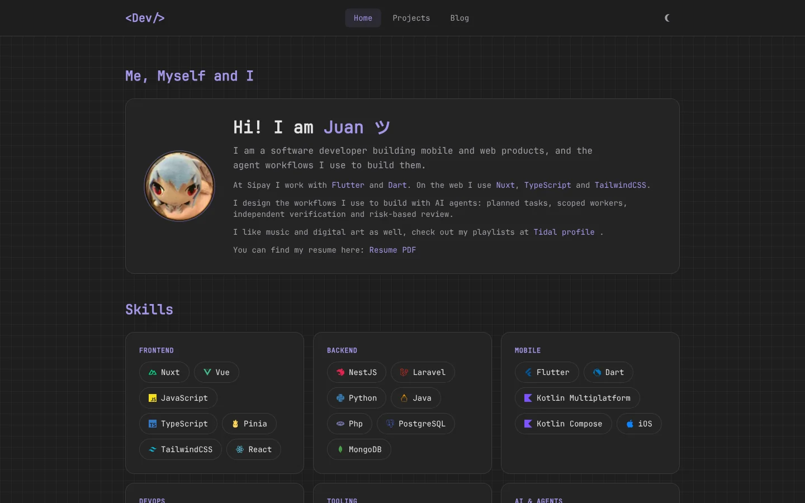
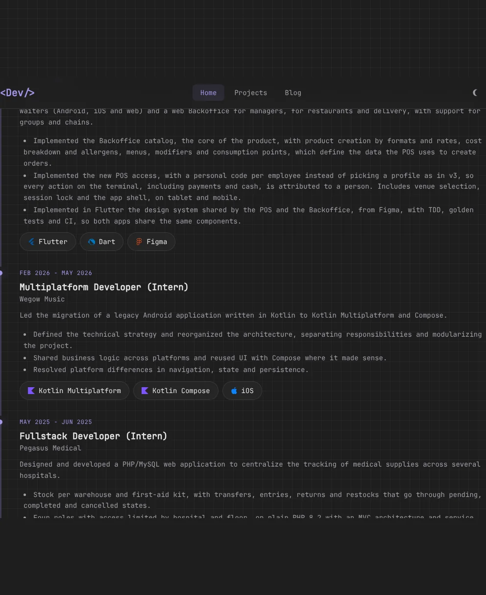
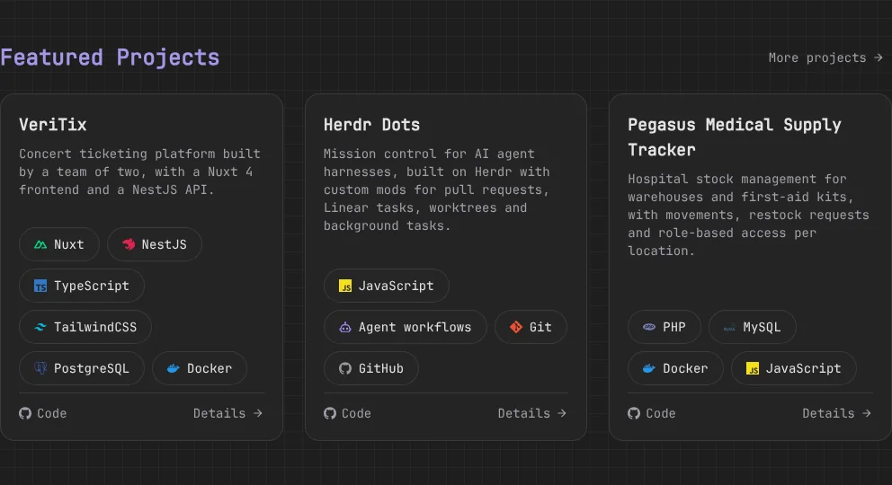

<div align="center">

# Portfolio

**My personal site: experience, projects, skills and writing.**

[**piioni.github.io/Portfolio**](https://piioni.github.io/Portfolio/)



</div>

A content-driven site built with Nuxt 4. Everything on it (experience, skills, projects, posts) lives in YAML and Markdown files, so updating the site means editing text, not components.

## Screenshots

<table>
  <tr>
    <td width="50%"></td>
    <td width="50%"></td>
  </tr>
  <tr>
    <td align="center"><sub>Experience timeline</sub></td>
    <td align="center"><sub>Featured projects</sub></td>
  </tr>
</table>

## Stack

- Nuxt 4, Vue 3 and TypeScript
- Tailwind CSS 4
- `@nuxt/content` for typed content collections
- `@nuxt/icon` with `simple-icons` and `mdi`
- `@nuxtjs/color-mode` for light and dark themes
- Vitest

## Run it

```bash
bun install
bun run dev          # http://localhost:3000/Portfolio/
```

| Script | What it does |
| --- | --- |
| `bun run dev` | Dev server |
| `bun run generate` | Static build, the same one the deploy uses |
| `bun run test` | Vitest |
| `bun run lint` | ESLint |
| `bun run typecheck` | Type check (see known issues) |

The site is served under `/Portfolio/`, set in `nuxt.config.ts` and overridable with `NUXT_APP_BASE_URL`.

## Updating the content

| To change | Edit |
| --- | --- |
| Jobs and internships | `content/portfolio/experiences.yml` |
| Skill groups | `content/portfolio/skill-groups.yml` |
| Projects (home shows the top 3 featured by `order`) | `content/projects/*.md` |
| Blog posts | `content/posts/*.md` |
| Social links and interests | `content/portfolio/social-links.yml`, `interests.yml` |
| Hero text | `app/components/sections/home/HeroSection.vue` |
| The resume | replace `public/resume.pdf` |

`content.config.ts` validates every file with Zod: slugs must be kebab-case, URLs must be valid, and dates must be `YYYY-MM` or `YYYY-MM-DD`. A bad value fails the build, not the page.

**Adding a technology or skill** takes one extra step. Icons are an allowlist: register the id in `app/shared/icon-registry.ts` (both `ICON_IDS` and `ICON_REGISTRY`) and add its color class in `app/assets/css/main.css`. Skill categories are an enum in `content.config.ts` and `app/types/site.ts`.

## Architecture

```text
app/
  components/
    base/        Primitives with no domain logic
    compound/    Primitives combined for portfolio entities
    sections/    Page sections
  composables/   Content queries and theme
  shared/        Icon registry
  pages/         Final composition and SEO with useSeoMeta
content/
  portfolio/     Experience, skills, links, interests (YAML)
  projects/      One Markdown file per project
  posts/         One Markdown file per post
```

## Deploy

Every push to `main` runs `.github/workflows/deploy.yml`, which generates the static site and publishes it to GitHub Pages. That means merging to `main` updates the live site.

## Known issues

- `bun run typecheck` reports two type errors, in `app/pages/blog/[slug].vue` and `app/pages/projects/[slug].vue`, where the content query can return `undefined`. They do not affect the build.
